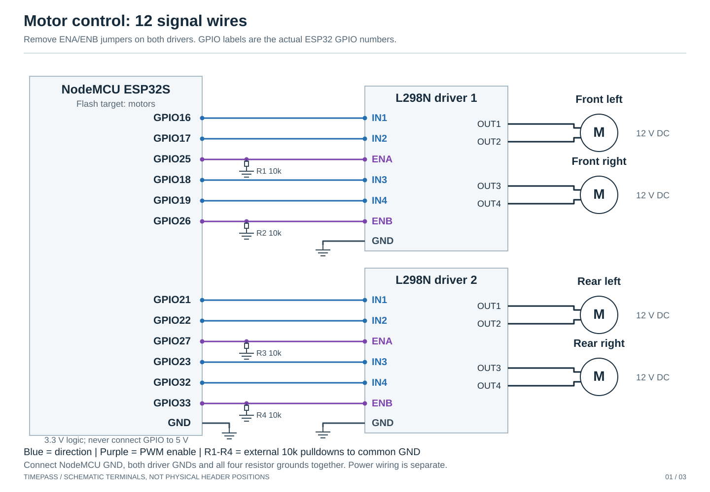
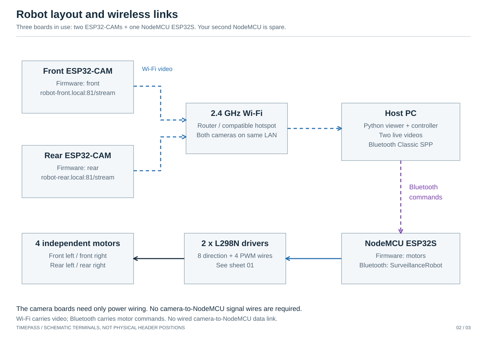
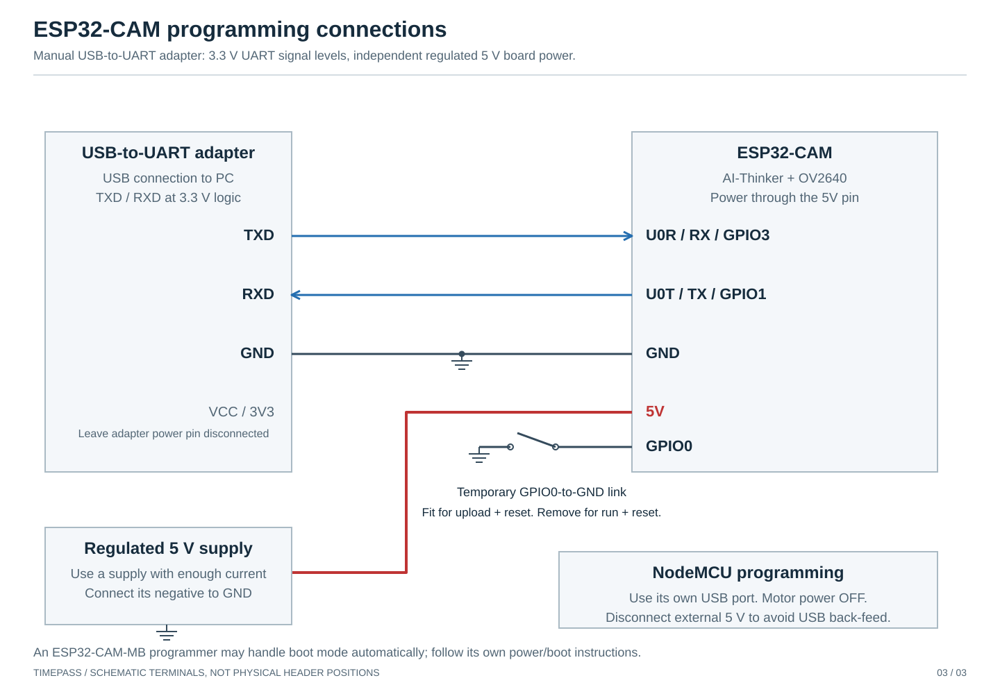

# Data and signal wiring

This guide matches the firmware's GPIO map. Use **both ESP32-CAMs for video** and **one NodeMCU ESP32S for motor control**. Your second NodeMCU is spare. Left/right refer to the robot's own perspective facing forward.

**[Download the three-page PDF](diagrams/data-wiring-pack.pdf)** or use the diagram files below. This guide covers data connections and their ground reference; supply/battery sizing is left to your build.

## NodeMCU to the two L298Ns



**Remove ENA and ENB jumpers from both drivers** before connecting the GPIO wires. ENA/ENB must be controlled by the NodeMCU for independent speed and stop control. Do not confuse these jumpers with a module's separate `5V-EN` regulator jumper.

| NodeMCU GPIO | Connect to | Purpose |
| --- | --- | --- |
| **16** | Driver 1 **IN1** | Front-left direction input A |
| **17** | Driver 1 **IN2** | Front-left direction input B |
| **25** | Driver 1 **ENA** | Front-left PWM speed / enable |
| **18** | Driver 1 **IN3** | Front-right direction input A |
| **19** | Driver 1 **IN4** | Front-right direction input B |
| **26** | Driver 1 **ENB** | Front-right PWM speed / enable |
| **21** | Driver 2 **IN1** | Rear-left direction input A |
| **22** | Driver 2 **IN2** | Rear-left direction input B |
| **27** | Driver 2 **ENA** | Rear-left PWM speed / enable |
| **23** | Driver 2 **IN3** | Rear-right direction input A |
| **32** | Driver 2 **IN4** | Rear-right direction input B |
| **33** | Driver 2 **ENB** | Rear-right PWM speed / enable |
| **GND** | **Driver 1 GND and Driver 2 GND** | Shared signal reference |

Fit **one external 10 kΩ pulldown resistor** from each of the four enable lines to the same common GND:

| Resistor | First end | Other end |
| --- | --- | --- |
| R1 | GPIO25 / Driver 1 ENA | Common GND |
| R2 | GPIO26 / Driver 1 ENB | Common GND |
| R3 | GPIO27 / Driver 2 ENA | Common GND |
| R4 | GPIO33 / Driver 2 ENB | Common GND |

Place these resistors at the driver inputs so they stay connected if the NodeMCU is unplugged. They keep the enables low during boot/reset or disconnection; they are not wires shorting ENA/ENB directly to GND. The drawn ground symbols are all the **same net**, and must be physically connected together.

These are **GPIO numbers, not physical header positions or assumed D-label numbers**. Read the labels on your NodeMCU board. Its signals are 3.3 V; never connect a GPIO to a 5 V rail. All motor signal wires originate from the NodeMCU running the `motors` target, not from either camera board.

### Motor output pairs

| Driver output pair | Motor |
| --- | --- |
| Driver 1 **OUT1 + OUT2** | Front left |
| Driver 1 **OUT3 + OUT4** | Front right |
| Driver 2 **OUT1 + OUT2** | Rear left |
| Driver 2 **OUT3 + OUT4** | Rear right |

Connect one motor per output pair. If one wheel runs backwards, swap that motor's two wires with power off, or change its `motorPolarity` entry in `firmware/include/robot_config.h` and reflash. The code sends PWM to ENA/ENB at 15 kHz; it does not send serial data to an L298N.

Downloads: [motor schematic PNG](diagrams/motor-wiring.png) · [motor schematic SVG](diagrams/motor-wiring.svg).

## Camera and wireless data connections



- **Front ESP32-CAM → Wi-Fi → PC:** flash `front`; stream at `http://robot-front.local:81/stream` or its printed IP address.
- **Rear ESP32-CAM → Wi-Fi → PC:** flash `rear`; stream at `http://robot-rear.local:81/stream` or its printed IP address.
- **PC → Bluetooth Classic SPP → NodeMCU:** pair `SurveillanceRobot` using your configured PIN; flash `motors` on that NodeMCU.
- **No TX/RX, I2C, SPI or other data wires connect the camera boards to the NodeMCU.** The OV2640 ribbon stays connected to its own ESP32-CAM board.
- The camera boards need 2.4 GHz Wi-Fi and the PC on the same LAN. Both feeds go directly to the PC. The second NodeMCU is unused.

Downloads: [wireless layout PNG](diagrams/system-layout.png) · [wireless layout SVG](diagrams/system-layout.svg).

## ESP32-CAM programming data wires



For the illustrated manual USB-to-UART method, program one camera board at a time:

| Adapter / connection | ESP32-CAM terminal |
| --- | --- |
| Adapter **TXD**, 3.3 V logic | **U0R / RX / GPIO3** |
| Adapter **RXD** | **U0T / TX / GPIO1** |
| Adapter **GND** | **GND**, also shared with its power-supply negative |
| Temporary boot link | **GPIO0 to GND** during upload-mode reset only |

TX connects to RX, and RX connects to TX. The diagram shows a separate regulated 5 V supply to the camera's **5V** pin; leave the adapter's VCC/3V3 power output disconnected for that arrangement. Never put 5 V UART signals on the RX pin. Avoid two supplies back-feeding one another.

Fit the GPIO0-to-GND link, reset, upload `front` or `rear`, remove that link, then reset again to run. An ESP32-CAM-MB programmer may provide power and boot switching automatically; follow its own connections instead of mixing the two methods. The NodeMCU programs through its built-in USB port and needs no external UART wiring.

Downloads: [programming PNG](diagrams/camera-programming.png) · [programming SVG](diagrams/camera-programming.svg).

## Files and regeneration

Download [the interactive viewer](diagrams/interactive-wiring.html) and open it locally for tabs and zoom; GitHub normally displays its HTML source. The [PDF](diagrams/data-wiring-pack.pdf) contains the three sheets. Each diagram uses logical terminal positions, so actual module header order may differ.

```sh
python -m pip install -r requirements-docs.txt
python tools/generate_diagrams.py
```

The generator reads motor GPIO labels from `firmware/include/robot_config.h` and also writes a [JSON connection map](diagrams/wiring-map.json). The PDF and PNGs use the same drawing source as the SVGs. No documentation-only packages are needed to run the existing firmware or PC app.

The diagrams have been checked against the code. They do not imply physical testing of your boards. See the existing [setup instructions](../README.md) for flashing, Bluetooth pairing and PC controls, and [power wiring notes](wiring.md) when needed.
